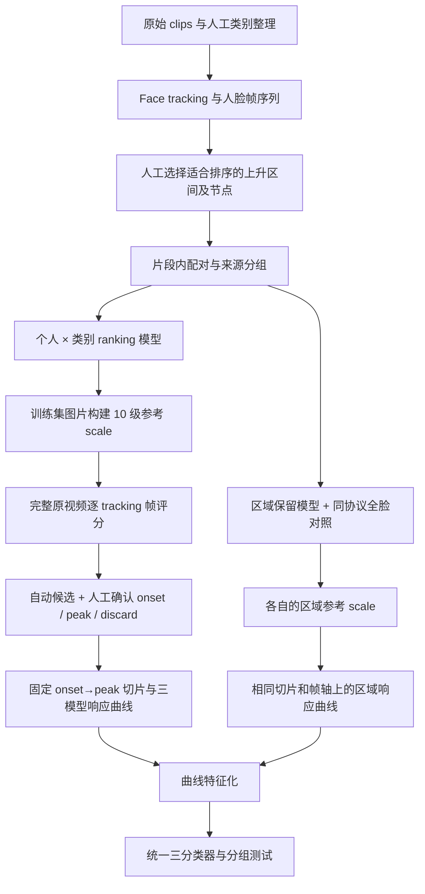

# Temporal Smile Analysis：研究内容、数据标注与建模方法

[GitHub 版实验结果与对比图](reports/temporal_smile/README.md)涵盖曲线摘要、单帧和完整时序三组实验。下文中指向 `output/`、`new_dataset/` 和 `E:/Dataset/` 的链接供原研究工作区使用。

> **后续实验（2026-11-09）：** [完整 18 通道张量时序实验](output/tensor_sequence_classification_20261109/index.html) 已比较固定 20 点与原始变长序列、双向 GRU、掩码 TCN 和轨迹核 SVM；另见 [11 月 5 日单帧分阶段实验](output/single_frame_phase_classification_20261105/index.html)。下文保留原研究快照，文末的 1D-CNN 设想现已有上述后续实验。


更新日期：2026-11-05  
工作区：`E:/Single_frame_smile`  
文档用途：记录本项目已经实施的研究流程、方法选择、数据版本、结果和限制。供后续实验、论文方法整理及新窗口交接使用。本文描述截至更新日的已完成实验，不将后续设想写成已完成工作。

## 1. 研究问题与整体思路

本研究关注 polite smile、bitter smile 和 true smile 三类表情在时间发展过程中的差异。研究对象不仅是一张图片的外观，也包括笑容从开始增强到峰值期间，不同模型、不同面部区域的响应如何变化。

目前采用两层模型：

1. **个人化 smile ranking 模型**：比较两张人脸图片的相对笑容强度。按“参与者 × 表情类别”分别训练，区域实验进一步增加输入区域条件。
2. **统一的三分类器**：将同一片段通过多个个人 ranking 模型得到的曲线转换成特征，再预测该片段属于 polite、bitter 还是 true。最终三分类器由五个人的数据合并训练，不是每人一个分类器；人物 ID 没有作为分类输入特征。

研究假设是：单个 ranking 分数未必能区分类别，但不同模型、不同区域对同一片段的**响应组合**可能包含类别信息，例如起点水平、增幅、平均响应和上升时长。



这里的 `true smile` 是数据提供时使用的类别标签。它不是经过独立情感真实性鉴定的心理状态；ranking 强度也不是情绪真实性分数。

## 2. 当前研究数据与版本边界

### 2.1 当前参与者

本轮使用 **JIANG、JIE、TAKEDA、XU、YAMAMOTO** 五个人，每人包含 polite、bitter、true 三类。REN 按用户要求不参与本轮训练和推理；MATSUDA 的历史实验也不在本轮范围中。

历史上曾交付过包含 REN、尚未包含 JIE 的 1,029 段 start→peak 数据。那是较早版本，不能用来代表本报告的当前样本量。

### 2.2 完整视频评分与最终分析片段

本轮先对 **1,235 段已分类原始 clips** 的 **120,364 张已保存 tracking 人脸帧**评分，再进行 onset/peak 审阅。最终接受 **1,215 段**，Discard **20 段**。

| 参与者 | 原始评分 clips | Polite 接受数 | Bitter 接受数 | True 接受数 | 接受合计 | 时序审阅 Discard |
|---|---:|---:|---:|---:|---:|---:|
| JIANG | 367 | 147 | 145 | 75 | 367 | 0 |
| JIE | 222 | 92 | 55 | 74 | 221 | 1 |
| TAKEDA | 199 | 94 | 44 | 50 | 188 | 11 |
| XU | 225 | 81 | 61 | 75 | 217 | 8 |
| YAMAMOTO | 222 | 57 | 90 | 75 | 222 | 0 |
| **合计** | **1,235** | **471** | **395** | **349** | **1,215** | **20** |

最终 onset→peak 区间包含 **26,680 张可用 tracking 人脸帧**。视频切片保留源视频中 onset 到 peak 的全部解码帧，而曲线只在确实保存了有效人脸 tracking 结果的帧上有分数。二者帧数不一定相同。

“原始 clips”指当前已分类目录中的源视频文件。分类阶段已经移出的 Discard、无类别数据和没有本轮模型的参与者没有被悄悄混入评分范围。

### 2.3 三套容易混淆的数据规模

| 数据用途 | 当前规模 | 含义 |
|---|---:|---|
| Ranking 训练来源 | 323 个 Accepted clips，6,832 对 | 人工选节点后产生的强弱比较训练资料 |
| 全视频评分 | 1,235 clips，120,364 tracking 帧 | 对原始完整轨迹评分，不只对训练节点或旧切片评分 |
| 最终时序分析／三分类候选 | 1,215 个审核区间 | 作为三模型及区域曲线比较、三分类实验的 clip 单位 |

6,832 个配对不能当作 6,832 个独立视频样本；同一 clip 的多个配对共享图片和表情过程。

## 3. 数据标注过程

### 3.1 类别标注

未分类视频通过网页逐段查看，人工选择 `Polite`、`Bitter` 或 `Discard`。页面支持视频播放、快捷键、进度保存和 JSON 导出。核验导出身份及文件信息后，再移动源视频到相应类别目录。

例如，JIE 的 150 段未分类视频最终为 92 polite、55 bitter、3 discard。bitter 的物理目录按用户指定保留拼写 `E:/Single_frame_smile/new_dataset/JIE/biiter`，但清单和模型的类别键统一为 `bitter`。True 类视频的初始类别来自用户提供的目录。

分类阶段的 Discard 与后续时序切分阶段的 Discard 是不同记录，不应相加后混称同一种排除原因。原文件按流程单独保留，网页选择本身不直接删除文件。

### 3.2 Face tracking

复用现有 FaceTracking 工程，对原视频检测、追踪和裁剪人脸，输出 224×224 RGB 人脸图片。现有配置使用 orientation threshold 15；每张图片保留源帧编号，时间从原视频解码时间戳取得。

后续代码复用已保存的有效追踪帧，不把缺失帧填成重复人脸或虚构 ranking 分数。多轨迹、无轨迹等情况需要明确处理，不能将不同人的轨迹静默混合。

JIE 的三类共 222 段完成追踪，取得 17,704 张人脸帧；JIANG 新增 true 的 75 段取得 17,823 张人脸帧。相关索引见各实验目录的 `sequences.csv`。

### 3.3 早期 ranking 标注方法：独立人工比较图片对

早期流程从完整的有效人脸帧序列中沿时间均匀抽取约 10 张候选图片。在同一人物、同一类别内，从不同 clips 组成随机图片对，随机交换左右位置，然后人工标记：左边更强、右边更强、相近、舍弃。

当时的强弱标签**不来自帧的先后顺序**。时间位置只用于抽样，不能当作笑容强度。相近和舍弃的配对不进入当时的二分类比较损失。

此版本用于早期模型和初始曲线，不能把它的标签来源直接套用到本轮重新训练的数据上。

### 3.4 本轮 ranking 标注方法：人工接受的上升片段与时间顺序配对

本轮改用以下流程：

1. 查看视频和已有 ranking 曲线，选择适合强度排序的上升区间。
2. 人工调整训练起点、终点，并增加或移除图片节点。
3. 对整段候选选择 Accept 或 Reject。
4. 将接受区间的节点按源时间排序，在片段内部生成全部两两配对。

最初的自动候选使用约 0.2 秒采样间隔，15 FPS 时约等于每 3 帧取一张。短片尝试选 5 帧，保持至少 2 个源帧的间隔；长片可选更多帧。后来网页允许完全手动增删节点、接受不足 5 帧的选择，实际训练配对仍过滤源帧差小于 2 的配对。

如果选中五张图片，编号为 1、2、3、4、5，配对为：

```text
12 23 34 45
13 24 35
14 25
15
```

一般情况下，n 张图片产生 n(n−1)/2 对，再应用有效帧间隔检查。输入左右位置随机交换，并同步调整标签。

**本轮监督标签的关键假设是：在人工接受的区间中，较晚的选中节点比较早节点笑容更强。**人工允许小幅回退，因此它是基于片段接受和时间顺序生成的弱监督排序标签，不是每对图片都经过独立人工比较。Accept 也不证明曲线在数学上严格单调。

JIANG true 和 JIE 的三个类别原先没有旧曲线，采用“视频＋空时间轴”手动选择节点。该页面的直线只表示时间，分数字段为空，没有把直线伪装成模型评分。

### 3.5 Ranking 数据冻结

本轮使用的审阅导出为：

[monotonic_ranking_decisions_2026-11-01T10-16-30-097Z.json](E:/Single_frame_smile/output/monotonic_ranking_review_20261029/monotonic_ranking_decisions_2026-11-01T10-16-30-097Z.json)

只使用 Accepted clips，排除 REN 后得到 323 clips、6,832 对有效配对。未审阅、拒绝的候选不参与这次 ranking 训练。网页中的 280 pairs 是每个人／类别的**训练＋验证＋测试总量提醒**，不是训练集单独需要 280 对，也不是把超过 280 的数据截断丢掉。

## 4. Ranking 模型训练与数据独立性

### 4.1 基础个人模型

对五个人的三个类别分别训练，共 15 个基础 ranking 模型。模型输入是两张人脸图，输出两个相对强弱方向的比较 logits。

模型使用冻结的 VGGFace 卷积主干提取特征，再训练 Siamese comparison head。卷积特征维度为 512×7×7=25,088；两张特征拼接后输入比较头，结构为：

```text
50,176 → 512 → 256 → 256 → 2
中间包含 ReLU 和 Dropout(0.25)
```

训练同时比较 `(A,B)` 和 `(B,A)`，损失为：

\[
L=CE(z_{AB},y)+CE(z_{BA},1-y)+(1-C),
\]

其中 C 衡量交换图片后两个方向预测的一致性。它不是时间斜率损失。模型看的是静态图片对，不直接读取时间戳或要求整段预测单调。

基础模型训练使用 Adam，学习率 5×10⁻⁵、batch size 32、100 epochs；以验证损失选择 checkpoint，再评估测试集。训练包含随机水平翻转和连续随机 ±5° 旋转。模型从原始预训练主干开始训练，不在旧个人 checkpoint 上续训。

### 4.2 Ranking 的分组划分

重新按接受片段划分集合，目标约为 70%／15%／15%。完整 clip、可识别的同源片段、重复源视频和相同解码人脸图片组成联合分组，再整体划分，不将同一 clip 的不同图片或配对拆到不同集合。

| 集合 | Accepted clips | 有效配对 |
|---|---:|---:|
| Train | 228 | 4,797 |
| Validation | 49 | 1,010 |
| Test | 46 | 1,025 |
| **合计** | **323** | **6,832** |

这里的划分以 [accepted_manifest.json](E:/Single_frame_smile/output/monotonic_accepted_training_20261101/accepted_manifest.json) 中的 `split` 为准，`review_split` 是旧网页划分，仅供追溯。分组方案按配对数量接近目标比例来选择，不按模型准确率选择。

来源组主要根据已有源关系、文件名去掉 `_P数字` 后的标识和重复检查构造。对于只有 `expression_XXX` 等文件名的数据，不能据此声称训练与测试来自完全独立的录制会话。

## 5. 10 级 smile scale 与逐帧 scoring

### 5.1 参考 scale 如何构成

每个个人／类别 ranking 模型分别构建自己的 scale：

1. 只取其训练集中的候选图片，不使用验证或测试图片。
2. 由训练好的比较模型对候选图片做所有两两比较。
3. 结合交换方向后的概率计算对称比较结果，用 hard wins 主导、平均比较概率打破并列来排序。
4. 从由弱到强的排序列表中，按排序位置等间隔选出 10 张，标记 Level 0～9。

Scale 的排序由模型比较得到，不直接按图片时间顺序排列。Level 0 是该候选库中相对最弱的图片，不必然是 neutral；相邻等级也不是经过验证的等强度间隔。

### 5.2 每帧分数的定义

设当前帧为 I，参考图片为 A₁,…,A₁₀。对每个参考图，分别输入 `(I,A_j)` 与 `(A_j,I)`：

\[
p_j(I)=\frac{P(\text{左图更强}\mid I,A_j)+P(\text{右图更强}\mid A_j,I)}{2}.
\]

本轮绘图分数为：

\[
s(I)=\operatorname{clip}\left(\sum_{j=1}^{10}p_j(I)-0.5,\ 0,\ 9\right).
\]

因此它是相对于这套参考库的连续排序响应，不是类别概率。CSV 同时保留平均比较概率等信息。每个模型都有自己的参考库，不能假定不同模型的 0～9 已经统一校准。

## 6. t–smile ranking plot 与 onset→peak 区间

### 6.1 完整原视频曲线

先使用对应“人物＋类别”的基础模型，对完整原始 clip 的每一张已保存 tracking 人脸帧评分。此时不限制在旧 start→peak 区间，也不只计算训练节点。

- 横轴：源视频解码时间戳，单位秒。
- 纵轴：上述 0～9 ranking response。
- 原始曲线：逐帧模型分数。
- 平滑曲线：以当前时间为中心、宽度约 0.10 秒的中位数平滑。
- 缺失 tracking 帧：保留缺失，不生成假的分数；展示遇到较大的追踪缺口会断开。

原始分数和平滑分数均保存，平滑不强制单调。自动边界检测另使用高斯时间平滑，不能把它与展示用中位数平滑混为一谈。

### 6.2 Start、onset、peak 的版本区别

早期流程的 start 用来保留上升之前的低分基线；onset 是持续越过低分阈值的位置。之后对部分 start 做过向前回溯，并经过人工确认。这些属于旧的切分流程。

当前分析使用重新审阅的 **onset→peak**：网页允许点击两个时间点，自动将较早点定义为 onset、较晚点定义为 peak，也允许数值或当前视频帧选择。这些是当前研究的操作性边界，不能直接称作已通过生理学验证的表情起始点。

### 6.3 自动建议与人工确认

用户先完成了 109 段 JIANG/polite 标注。自动检测用其中 74 段调参，另按同源组保留 35 段测试。选中的启发式参数为：

- 高斯时间平滑 σ=0.08 秒，不跨较大 tracking 缺口借用样本。
- 以平滑峰值之前的 15% 分位数作为低分参考。
- 在受支持的低分区间后寻找首次持续超过 10% 上升幅度的位置，作为 onset 候选。
- 在主要平滑峰值前，寻找进入最终 95% 峰值高度区间的位置，作为 peak 候选。
- 弱信号、多次回到低分区、追踪缺口和靠近视频边界的峰值会标记提示。

35 段保留测试上的 onset MAE 为 0.088 秒、peak MAE 为 0.053 秒；30/35 段的两个边界误差都不超过 0.20 秒。这只能描述该 JIANG/polite 校准样本，不能推广成五个人三类的已验证检测性能。

自动建议对全部 1,235 段运行，1,233 段生成有效候选。建议保持 pending，由用户微调、Accept 或 Discard，既有人工决定优先。

最新完整导出：

[full_clip_onset_peak_2026-11-02T07-46-15-374Z.json](E:/Single_frame_smile/output/full_clip_ranking_review_20261102/full_clip_onset_peak_2026-11-02T07-46-15-374Z.json)

其中 1,215 Accepted、20 Discard。元数据记录 1,077 条 `human_confirmed`、138 条 `human_confirmed_auto`、20 条 `human_discard`。应称为“人工确认的最终区间”，不能称所有边界都从零手绘。

### 6.4 切片与三模型曲线

根据最终 JSON 实际导出 onset 到 peak 的视频，源帧号从 0 开始，包含 peak 帧。采用解码帧序号裁切，保留变帧率时间关系，并核对导出帧数。

对同一段视频中的同一组 tracking 帧，使用同一个人的 polite、bitter、true 三个模型分别评分，不因输入的真实类别而只挑一个模型。

- 切片图横轴：源时间减去 onset 时间，从 0 秒开始。
- 蓝色：polite 模型；绿色：true 模型；红色：bitter 模型。
- 点：实际评分帧；折线连接有效相邻观测。
- 所有模型使用相同的 onset/peak 和帧轴，不为每条曲线各自重新切片。
- 该区间内重新计算相同规则的 0.10 秒中位数平滑，避免三条曲线使用不同的边缘处理。
- 下方最多显示 10 张真实人脸静帧，覆盖区间，点击静帧或曲线可定位视频。

[当前视频与多模型曲线展示页](E:/Single_frame_smile/output/three_model_clip_gallery_20261102/index.html)

## 7. 曲线观察如何推动三分类研究

对 1,215 段的探索性统计表明，三模型曲线常一起上升，主要差异体现在响应基线、幅度和时长。按视频类别统计，每条平滑曲线的端点差中位数为：

| 输入视频类别 | Polite 模型增幅 | Bitter 模型增幅 | True 模型增幅 |
|---|---:|---:|---:|
| Polite | 6.40 | 4.86 | 2.37 |
| Bitter | 4.91 | 6.54 | 2.21 |
| True | 4.19 | 5.60 | 6.69 |

对应 onset→peak 时长中位数为 0.533、0.567、0.769 秒。True 相对 polite 更长的方向出现在这五个人中，但幅度有个人差异；归一化后的平均上升形状高度重叠。

这些观察提出了一个可测试假设：**三个增幅的组合可能比“哪个模型的绝对分数最高”更有分类价值**。这是描述性线索，不能直接称为三种笑容的普遍生理规律，因为模型训练和区间选择本来就偏向上升过程。

## 8. 第一轮三分类器：全脸曲线特征

### 8.1 分类单位与输入

每个 clip 是一个分类样本。输入来自同一个人的三个基础 ranking 模型，不把真实类别、人物 ID、文件名或路径作为数值分类特征。

预设比较四类特征：时长单独、三个增幅、三个增幅＋时长、更完整的曲线水平与形状。

最终基线使用四个数值：

\[
\mathbf{x}_{base}=[T,\Delta s_{polite},\Delta s_{bitter},\Delta s_{true}].
\]

其中 Δs 是端点差，不是时间导数；不能把它直接叫作斜率。

### 8.2 分类器的独立分组

分类数据固定为：

| 集合 | Clips | 来源组件 |
|---|---:|---:|
| Train | 879 | 440 |
| Validation | 159 | 93 |
| Test | 177 | 86 |

分组联合 clip/source family、重复源视频、上游的联合分组和解码后相同人脸图片。分类测试组排除了同一参与者三个 ranking 模型训练、验证接触过的来源组件，而不只是排除同类别模型的训练视频。

必须使用当前有效分组，不将帧或配对重新随机拆分。分类器标准化仅在 classifier train 上拟合。

### 8.3 基线结果

在相同分组下比较正则化逻辑回归和随机森林，以验证集 macro-F1 选择。最终基线是 `StandardScaler + LogisticRegression(C=0.1, class_weight=balanced)`。

| 特征／规则 | 测试 ACC |
|---|---:|
| 直接选择平均响应最高的模型 | 54.80% |
| 仅时长 | 44.63% |
| 三个增幅 | 87.57% |
| **三个增幅＋时长** | **88.14%（156/177）** |
| 更完整的水平与形状特征 | 87.57% |

基线 balanced accuracy 为 88.37%，macro-F1 为 0.8817。这说明本轮有效信息主要来自多个模型的增幅组合，加入时长只多判断正确 1 段。

[第一轮分类报告](E:/Single_frame_smile/output/three_class_curve_classifier_20261102/index.html)

## 9. 面部区域实验与 matched control

### 9.1 为什么加入区域模型

全脸模型可能同时响应多个面部动作。区域实验希望检查眼周、鼻部、嘴部等局部响应是否提供全脸摘要遗漏的互补信息。这里测试的是模型输入条件，不是直接测量动作单元，也不是对某块肌肉做因果干预。

本轮采用 **keep-region**：只保留指定区域，其余像素填固定值；没有在本轮同时训练“遮住指定区域、保留其余部分”的反向版本。

### 9.2 遮罩构造

每个人从 ranking 训练集选择 30 张图片，三个类别各 10 张，用 68 点人脸关键点建立中位几何，并仅依据训练样本做固定的小幅扩张。之后该人物全部类别和所有帧共用相同遮罩，不让边界随当前表情变化。

| 区域键 | 保留内容 |
|---|---|
| `periocular` | 眼睛、眉眼及眼周，覆盖眼角 |
| `nose` | 鼻梁、鼻尖、鼻翼及邻近两侧 |
| `mouth_perioral` | 嘴唇及嘴角周围 |
| `upper_face` | 中位面部轮廓内、中位鼻尖高度以上 |
| `lower_face` | 中位面部轮廓内、中位鼻尖高度及以下 |
| `full` | 完整人脸裁剪，作为同协议全脸对照 |

遮罩外填固定 VGG RGB mean `[129.1863, 104.7624, 93.5940]`。不使用每张图隐藏区域的平均颜色或模糊图，以免保留额外信息。模型使用浮点遮罩图；PNG 仅用于显示，舍入不参与实际评分。

训练采样中的眼角、嘴角和鼻翼关键点覆盖率为 100%，但这不是全部测试图的覆盖保证。固定遮罩可能漏掉极端裁剪／姿态偏移；扩张后的细区域有少量重叠。上、下脸在中位轮廓内互补。

### 9.3 为什么有新的 full-face control

区域实验使用六个固定增强视图：原图、水平镜像、±5° 旋转、镜像后 ±5° 旋转。冻结卷积主干的特征预先缓存；验证和测试只用 native view 0。

这与基础 15 个模型每次随机翻转／连续旋转的训练不同，因此新增同协议全脸对照，控制训练方式改变的影响。区域模型与 matched full control 使用相同配对、划分、增强调度和训练设置。

全部新模型固定训练 100 epochs，Adam 5×10⁻⁵、batch size 32，使用原比较损失；按样本加权的验证损失选择 checkpoint，最后评估测试集。

新模型共 **5 人 × 3 类 ×（5 区域＋1 全脸对照）=90 个**：75 个区域 head、15 个 matched full head。连同原来的 15 个基础模型，本轮两种协议共有 105 个 ranking 模型配置。

新 checkpoint 保存比较 head；冻结主干路径和哈希记录在 checkpoint 中，不能只搬走 `head.pth` 后删除其主干依赖。

### 9.4 区域量表与曲线

每个新模型重新用其训练集 native-view 图片构建独立 10 级 scale，方法与基础量表一致。区域查询图必须与相同人物、类别、区域的参考特征比较，不能混用全脸 anchors。

本轮完成 90 套新 scale。每个最终 clip 新增 18 条曲线，即 6 种输入条件 × 3 个类别模型，共 **21,870 条新曲线**。加原来的三条，展示页最多有 21 条可选曲线。

为了减少重复计算，在冻结主干和预处理相同的前提下，共用同一遮罩图的卷积特征供三个类别 head 使用。比较头第一层的拼接线性投影也做了代数分解加速，并与直接计算做数值一致性检查；并未用一个模型的预测冒充另一个模型。

## 10. 曲线特征化的精确定义

以下特征基于所选区间内的平滑曲线 y(t)，T=t₁−t₀，使用实际秒数：

| 特征 | 定义 | 含义 |
|---|---|---|
| `duration` | T | 上升区间时长 |
| `start` | y(t₀) | 起点响应 |
| `end` | y(t₁) | 终点响应 |
| `delta` | y(t₁)−y(t₀) | 端点增幅，不是导数 |
| `mean` | 梯形积分 ∫y(t)dt / T | 按实际时间加权的均值 |
| `range` | max(y)−min(y) | 分数范围 |
| `downward` | 负向相邻变化绝对值之和 / span | 回退量 |
| `variation` | 所有相邻变化绝对值之和 / span | 总变化量 |
| `progress25/50/75` | 相应时间比例处的插值分数减 start，再除 span | 上升在时间上的分配 |

其中 `span=max(range,0.25)`，防止近乎平坦时归一化发散。25% 等比例用于特征插值，不会把原始视频时长丢掉。

当前最终选中的区域三分类器使用 **73 维输入**：

\[
\mathbf{x}_{regional}=[T,\{start_m,end_m,delta_m,mean_m\}_{m=1}^{18}].
\]

即 18 条新曲线 × 4 个摘要＋1 个时长。18 条包含新 full control 的三条和五个区域的十五条，**不额外拼入网页保留的旧三条曲线**。

虽然比较过包含更多形状指标的特征家族，最终胜出的 73 维模型没有使用完整时间序列，也没有使用 `progress`、`variation` 等形状字段。不能把当前结果表述为时间序列深度网络的结果。

## 11. 区域特征三分类实验与结果

### 11.1 训练和模型选择

沿用第一轮固定的 879／159／177 分类划分，不重新选择 clip 或 onset/peak。比较逻辑回归、随机森林、直方图梯度提升和 RBF-SVM，并比较单区域、区域组合、全脸与区域组合等预设特征家族。

本轮按**验证集 accuracy 优先、macro-F1 打破平局**选择；这不同于第一轮单独使用验证 macro-F1。测试集不参与参数和特征选择，选择结果先保存，再评估测试。

最终选中 `all_levels / rbf_C10`：`StandardScaler + SVC(C=10, gamma=scale, class_weight=balanced)`，输入上述 73 维特征。它是五个人共用的下游分类器，前面的 ranking 模型仍是个人化模型。

### 11.2 主结果

| 指标 | 原四特征逻辑回归 | 验证集选中的区域 SVM |
|---|---:|---:|
| 测试正确数 | 156/177 | 158/177 |
| 测试 ACC | 88.14% | 89.27% |
| 测试 balanced accuracy | 88.37% | 89.77% |
| 测试 macro-F1 | 0.8817 | 0.8994 |

新模型验证 ACC 为 94.34%。测试中修正了原模型 11 个错误，同时新增 9 个错误，净增 2 段。按 86 个来源组件 bootstrap 的准确率差 95% 区间约为 **−4.19 至 +6.22 个百分点**，包含 0，尚不能认为已经获得稳定提升。

### 11.3 单区域与组合对照

单区域实验输入该区域三个模型的增幅＋时长；每行分类器由验证集选择，测试均为相同 177 clips。

| 特征条件 | 三分类测试 ACC |
|---|---:|
| 同协议 full control 增幅＋时长 | 85.31% |
| 眼部及眼周 | 72.88% |
| 鼻部及鼻翼 | 70.62% |
| 嘴部及嘴角 | 79.66% |
| 上半脸 | 82.49% |
| 下半脸 | 81.36% |
| 五区域增幅＋时长 | 89.27% |
| 原全脸＋五区域增幅＋时长 | 90.40% |
| 同协议全脸＋五区域增幅＋时长 | 90.96% |
| **验证集选中的 73 维主模型** | **89.27%** |

90.96% 是一个预设对照在测试集上的成绩，不是测试前选出的主模型。不能在看过测试结果后将它改写成最终赢家。

### 11.4 Ranking ACC 与分类 ACC 是两种任务

下面是区域 ranking head 判断图片对相对强弱的测试成绩，按五个人的测试配对数加权。它不能与 177 clips 的三分类 ACC 混用。

| 输入区域 | Polite：366 对 | Bitter：303 对 | True：356 对 | 合计：1,025 对 |
|---|---:|---:|---:|---:|
| Full control | 99.73% | 99.67% | 98.03% | 99.12% |
| 眼部及眼周 | 92.08% | 81.19% | 86.80% | 87.02% |
| 鼻部及鼻翼 | 87.70% | 96.37% | 91.01% | 91.41% |
| 嘴部及嘴角 | 96.72% | 96.70% | 90.73% | 94.63% |
| 上半脸 | 95.08% | 98.35% | 92.98% | 95.32% |
| 下半脸 | 98.36% | 99.01% | 96.07% | 97.76% |

排序测试标签同样来自人工接受片段中的时间顺序假设，不是每对图片独立人工强度比较。高排序准确率不等于高类别辨别力。

## 12. 当前能支持的判断与主要限制

### 已有证据支持的有限判断

- 在当前参与者和已审核区间中，多个 ranking 模型的增幅组合具有三分类信息。
- 单看“哪条线最高”表现较差；学习响应组合优于直接取最大分数。
- 单一区域通常弱于全脸，多个区域可能提供互补信息。
- 区域扩展取得小幅测试提升，但结果存在个人差异，尚未证明稳定优势。

### 不能忽略的限制

1. **时间顺序弱标签**：本轮 ranking 的目标由接受区间的节点先后推定，局部回退或几乎相同的节点可能产生噪声标签。
2. **类别相关的边界选择**：onset/peak 参考过对应类别模型的曲线，再由人工确认。因此结果是已选区间的可分性，不是未知类别完整原视频的全自动识别能力。
3. **测试集已被查看**：区域实验沿用第一轮已经报告过的 177 段测试集，属于探索性配对扩展，不是新的独立确认实验。
4. **个人化上游**：统一三分类器依赖每个人已有的 ranking 模型。没有证明对全新人物无需个人数据即可泛化。
5. **量表未跨模型校准**：0～9 是每个模型自身参考库上的响应，不能解释为类别概率或统一物理强度。
6. **来源独立性有限**：按可确认的源关系分组并做重复检查，不等于已获得跨录制会话、跨设备、跨场景测试。
7. **外观与录制混杂**：眼镜、光照、头部姿态等仍可能影响区域模型。区域效果不能直接解释成肌肉因果重要性。
8. **区域及增强协议差别**：细 ROI 存在重叠，输入面积不同；新旧增强协议不同，需保留 matched control。
9. **样本相关性**：同一来源组可含多个 clips，评估不应把所有配对或同源 clips 当成完全独立观测。报告中的来源组件 bootstrap 比忽略组相关性的检验更适合作为描述性补充。

## 13. 后续研究方向：尚未执行

- 用与类别模型无关的规则或盲标确定边界，验证区间选择影响。
- 收集独立录制会话或新的参与者，建立未反复查看的最终测试集。
- 在相同 73 维输入上训练小型 MLP，与 SVM 做受控比较。
- 将多条曲线重采样到固定时间点，尝试浅层 1D-CNN，同时另保留原始时长，研究完整时序是否优于摘要特征。
- 补充独立人工图片对强度判断，以检查时间顺序标签的正确性。
- 如需解释区域作用，可补做“遮住 ROI、保留其余部分”的反向实验，并考虑面积、边界和录制因素控制。

这些是建议，不代表已训练过 MLP、1D-CNN 或反向遮挡模型。当前最终下游模型仍为传统分类器。

## 14. 主要文件、入口与复现定位

### 14.1 原数据与追踪

- 原始分类视频根目录：[new_dataset](E:/Single_frame_smile/new_dataset)。当前参与者为 JIANG、JIE、TAKEDA、XU、YAMAMOTO。JIE bitter 对应物理目录 `JIE/biiter`；TAKEDA true 对应 `TRUE`。
- 原三人与 TAKEDA 的个人实验位置可查：[DATASET_LOCATIONS.json](E:/Single_frame_smile/output/all_people_relaxed_start_20261026/DATASET_LOCATIONS.json)。这是较早目录表，包含 REN，不包含后来新增的 JIE 和 JIANG true，不能直接当作当前研究范围。
- JIANG 新增 true 的 tracking／sequences：[person_smile_JIANG_true_20261031/JIANG](E:/Dataset/person_smile_JIANG_true_20261031/JIANG)。
- JIE 三类别 tracking／sequences：[person_smile_JIE_20261031/JIE](E:/Dataset/person_smile_JIE_20261031/JIE)。
- 当前完整视频与模型映射：[sources.json](E:/Single_frame_smile/output/full_clip_ranking_review_20261102/sources.json)、[models.json](E:/Single_frame_smile/output/full_clip_ranking_review_20261102/models.json)。按 source SHA256 关联追踪，避免类别移动后按旧目录误配。

### 14.2 标注、模型、曲线与分类器

| 目的 | 入口 |
|---|---|
| 单调片段／节点标注及导出 | [monotonic ranking review](E:/Single_frame_smile/output/monotonic_ranking_review_20261029/index.html) |
| 冻结 ranking 数据与 15 个基础模型 | [accepted training](E:/Single_frame_smile/output/monotonic_accepted_training_20261101) |
| 基础模型 10 级量表 | [scale10](E:/Single_frame_smile/output/monotonic_accepted_training_20261101/scale10/index.html) |
| 全视频曲线与 onset/peak 审阅 | [full clip review](E:/Single_frame_smile/output/full_clip_ranking_review_20261102/index.html) |
| 自动边界的分组评估 | [auto boundary evaluation](E:/Single_frame_smile/output/full_clip_ranking_review_20261102/auto_boundary_evaluation.html) |
| 实际 onset→peak 视频及多模型曲线 | [clip gallery](E:/Single_frame_smile/output/three_model_clip_gallery_20261102/index.html) |
| 第一轮四特征分类器 | [baseline classifier](E:/Single_frame_smile/output/three_class_curve_classifier_20261102/index.html) |
| 区域实验、遮罩样张和总览 | [regional extension](E:/Single_frame_smile/output/regional_ranking_extension_20261103/index.html) |
| 区域分类结果与对照 | [regional classifier report](E:/Single_frame_smile/output/regional_ranking_extension_20261103/classifier/index.html) |
| 当前 73 维分类器文件 | [classifier.joblib](E:/Single_frame_smile/output/regional_ranking_extension_20261103/classifier/classifier.joblib) |
| 英文区域排序准确率图 | [ranking test plot](E:/Single_frame_smile/output/regional_ranking_extension_20261103/figures/regional_ranking_test_accuracy_en.png) |

基础模型准确路径记录在 `output/monotonic_accepted_training_20261101/models/<PERSON>/<TYPE>/latest.json`。区域 head 在 `output/regional_ranking_extension_20261103/models/<PERSON>/<TYPE>/<REGION>/head.pth`，对应 `protocol.json`、`metrics.json`、`complete.json` 可追溯训练设置与权重哈希。

全视频曲线的 CSV 位于 `output/full_clip_ranking_review_20261102/curves/<PERSON>/<TYPE>/<ID>/curve.csv`。切片曲线位于 `output/three_model_clip_gallery_20261102/curves/...`，区域曲线位于 `output/regional_ranking_extension_20261103/curves/...`。统一视频／边界索引是 [gallery manifest](E:/Single_frame_smile/output/three_model_clip_gallery_20261102/gallery_manifest.json)，该清单已增加区域曲线链接。

网页是查看入口；有效样本、边界、模型及 split 应以对应的冻结 JSON/CSV 清单为准。不要通过扫描所有 output 子目录中的视频或图片来计算数据量，因为其中包含备份、中间结果和重复展示文件。

### 14.3 核心脚本

| 脚本 | 主要用途 |
|---|---|
| [manual_ranking_sampling.js](experiments/person_smile/manual_ranking_sampling.js) | 节点、手动增删帧、时间顺序配对 |
| [train_accepted_grouped_20261101.py](experiments/person_smile/train_accepted_grouped_20261101.py) | Accepted-only 分组和基础 ranking 训练 |
| [train_smile_rank_with_holdout.py](annotation/train_smile_rank_with_holdout.py) | 基础 Siamese ranking 训练 |
| [build_accepted_scale10.py](experiments/person_smile/build_accepted_scale10.py) | 基础模型训练集 scale10 |
| [score_full_original_clips.py](experiments/person_smile/score_full_original_clips.py) | 原始完整 tracking 轨迹评分 |
| [auto_full_clip_boundaries.py](experiments/person_smile/auto_full_clip_boundaries.py) | 自动边界候选及分组测试 |
| [validate_full_clip_review.py](experiments/person_smile/validate_full_clip_review.py) | 导出边界与身份核验 |
| [build_three_model_clip_gallery.py](experiments/person_smile/build_three_model_clip_gallery.py) | 实际切片、三模型评分与展示 |
| [classify_three_curve_patterns.py](experiments/person_smile/classify_three_curve_patterns.py) | 基础曲线三分类 |
| [regional_masks_20261103.py](experiments/person_smile/regional_masks_20261103.py) | 训练集确定的固定区域遮罩 |
| [train_regional_ranking_20261103.py](experiments/person_smile/train_regional_ranking_20261103.py) | 90 个区域／对照 ranking head |
| [score_regional_curves_20261103.py](experiments/person_smile/score_regional_curves_20261103.py) | 区域 scale 与跨类别曲线 |
| [classify_regional_curves_20261103.py](experiments/person_smile/classify_regional_curves_20261103.py) | 区域特征三分类及冻结测试比较 |

运行环境为项目 `.venv/Scripts/python.exe`，另有历史 FaceTracking Python 环境和外部 SmileComp 代码依赖，具体绝对路径在 `experiments/person_smile/config.*.json`。部分脚本绑定了日期、固定输入快照和防重复执行检查；复现前先读脚本及对应 protocol，不要直接重跑已完成的移动、切分或训练脚本覆盖结果。

## 15. 研究结论的当前表述

现有结果支持：**在已建立个人 ranking 模型、并经过审核的笑容上升区间中，多模型响应的组合能够区分三类数据；区域响应提供了一些互补信息，但目前增益有限。**

本研究尚未证明：三种笑容具有跨人物、跨录制条件都稳定的独特动态形状；区域准确率能够直接解释肌肉因果机制；或者该系统已经能对未见人物的未知原视频进行全自动、无类别先验的分类。后续应优先加强独立边界、独立标签和独立测试，而不只继续增加模型数量。
