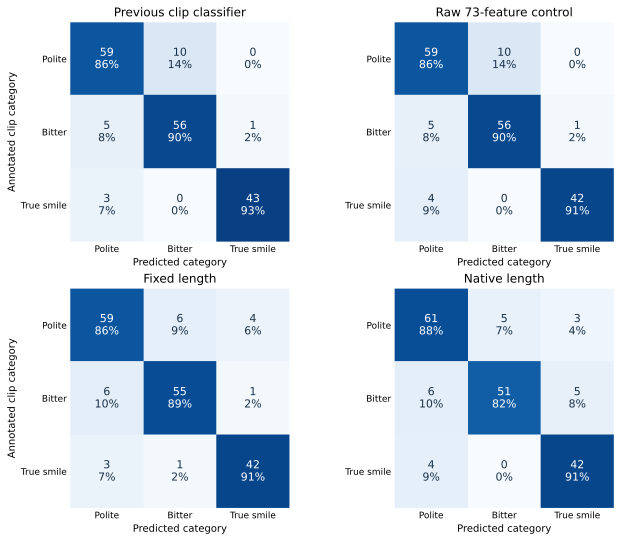
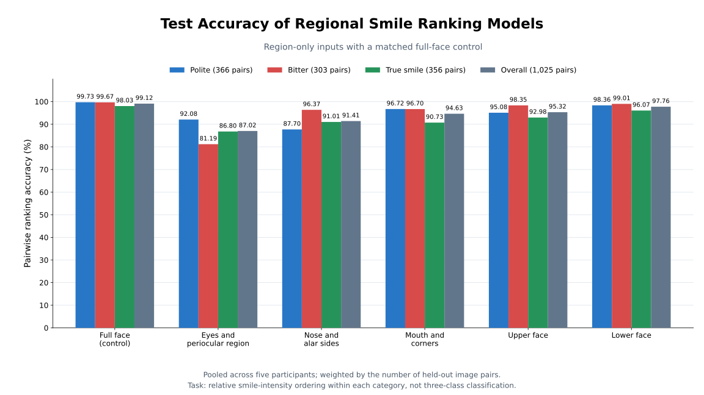

# Temporal smile classification

This report compares classifiers for polite, bitter and true smiles in five known participants. It summarizes experiments run on November 2–9, 2026. Each input interval begins at the reviewed onset and ends at the reviewed peak. The ranking channels come from the participant’s own models. Eighteen channels combine three smile ranking models with six facial regions (full face, periocular region, nose, mouth and mouth corners, upper face and lower face).

## Frozen evaluation cohort

| Split | Source groups | Polite clips | Bitter clips | True clips | Total clips | Tracked frames |
|---|---:|---:|---:|---:|---:|---:|
| Training | 440 | 342 | 290 | 247 | 879 | 19,425 |
| Validation | 93 | 60 | 43 | 56 | 159 | 3,429 |
| Test | 86 | 69 | 62 | 46 | 177 | 3,826 |

All classification experiments below use this split. Clips connected by source or exact decoded-face duplicates stay together. The split audit found zero test source groups exposed during training or validation of the upstream ranking models. Participants appear across splits, so the accuracy estimates apply to new clips from these five people.

## One prediction per clip

| Input | Classifier | Correct / 177 | Test accuracy | Test macro-F1 |
|---|---|---:|---:|---:|
| Three full-face endpoint changes and duration | Logistic regression | 156 | 88.14% | 0.8817 |
| 73 smoothed curve features | RBF-SVM | 158 | 89.27% | 0.8994 |
| 73 raw curve features | RBF-SVM control | 157 | 88.70% | 0.8934 |
| 20 resampled time points × 18 channels | Cosine coefficients + RBF-SVM | 156 | 88.14% | 0.8839 |
| Native time points × 18 channels | Cosine coefficients + RBF-SVM | 154 | 87.01% | 0.8703 |
| 20 resampled time points × 18 channels | Bidirectional GRU | 159 | 89.83% | 0.9033 |
| Native time points × 18 channels | Bidirectional GRU | 159 | 89.83% | 0.9033 |
| 20 resampled time points × 18 channels | Temporal convolutional network | 161 | 90.96% | 0.9147 |
| Native time points × 18 channels | Temporal convolutional network | 159 | 89.83% | 0.9046 |

The 73 features are each curve’s starting score, ending score, gain and time-weighted mean, plus clip duration. The tensor experiment used the 18 raw score channels, timing and duration. Recorded intervals ranged from 5 to 97 tracked frames. Resampling interpolated scores at 20 equally spaced times and masked slots that would bridge a tracking gap longer than 0.15 s.

Validation selected the native-length cosine-coefficient SVM as the primary tensor model. Compared with the smoothed 73-feature benchmark, its test accuracy differed by −2.26 percentage points (paired source-group bootstrap 95% interval −6.08 to +1.65). The fixed-length temporal convolutional network had the highest observed test accuracy in the family comparison. A fresh cohort would be needed to confirm an improvement after inspecting these results.

## Upstream ranking accuracy

The regional ranking models were evaluated on 1,025 held-out image pairs. Accuracy here measures how often a model correctly orders two frames by smile intensity. The figure breaks this down by region and smile category.

## One prediction per tracked frame

Each frame inherits its clip’s label. A separate classifier is selected for each tenth of elapsed onset-to-peak time. Pooled models train on all five participants. Personal models train on one participant each. The 3D input contains one full-face score per smile type. The 18D input adds the five regional sets of scores.

| Classifier scope | Input | Clip-bin weighted accuracy | Accuracy across 3,826 test frames |
|---|---|---:|---:|
| Pooled | 3D | 68.55% | 68.35% |
| Personal | 3D | 74.60% | 75.48% |
| Pooled | 18D | 83.81% | 82.91% |
| Personal | 18D | 85.31% | 84.79% |

The clip-bin metric gives each observed clip × time bin equal weight. The final column gives each observed frame equal weight. Assigning a phase requires the reviewed onset and peak. Category-specific ranking curves helped reviewers establish these boundaries, so this evaluation does not estimate performance on unsegmented video.

## Source records in the research workspace

The following paths are relative to the project root. They identify the original run records for readers with access to the local research dataset.

- `output/three_class_curve_classifier_20261102/report.json`
- `output/regional_ranking_extension_20261103/classifier/report.json`
- `output/single_frame_phase_classification_20261105/report_data.json`
- `output/tensor_sequence_classification_20261109/report_data.json`
